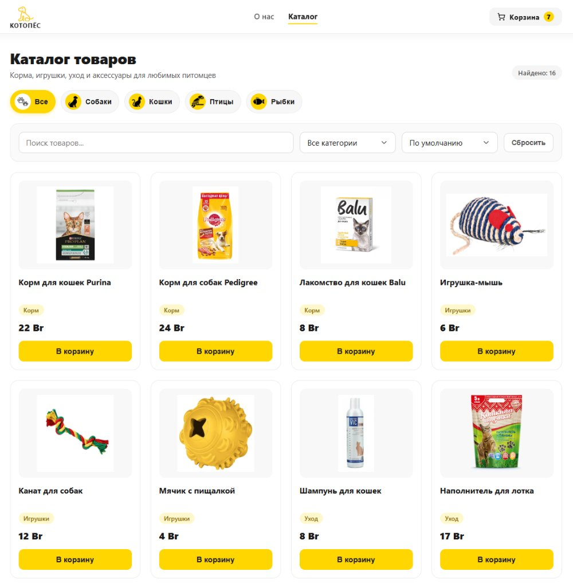
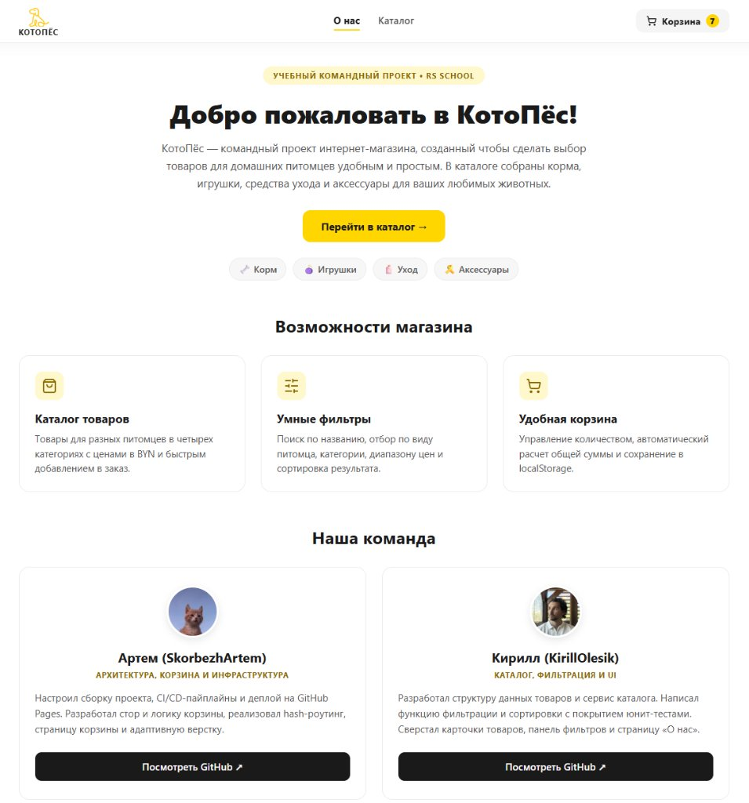
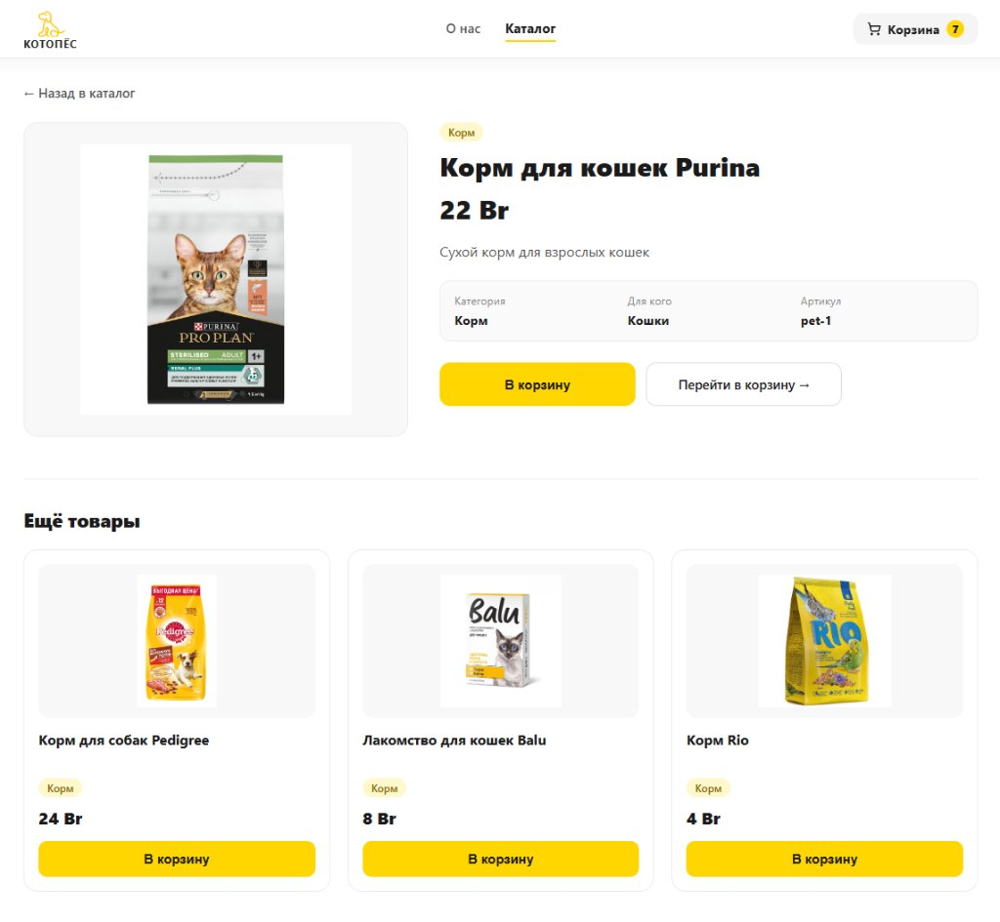
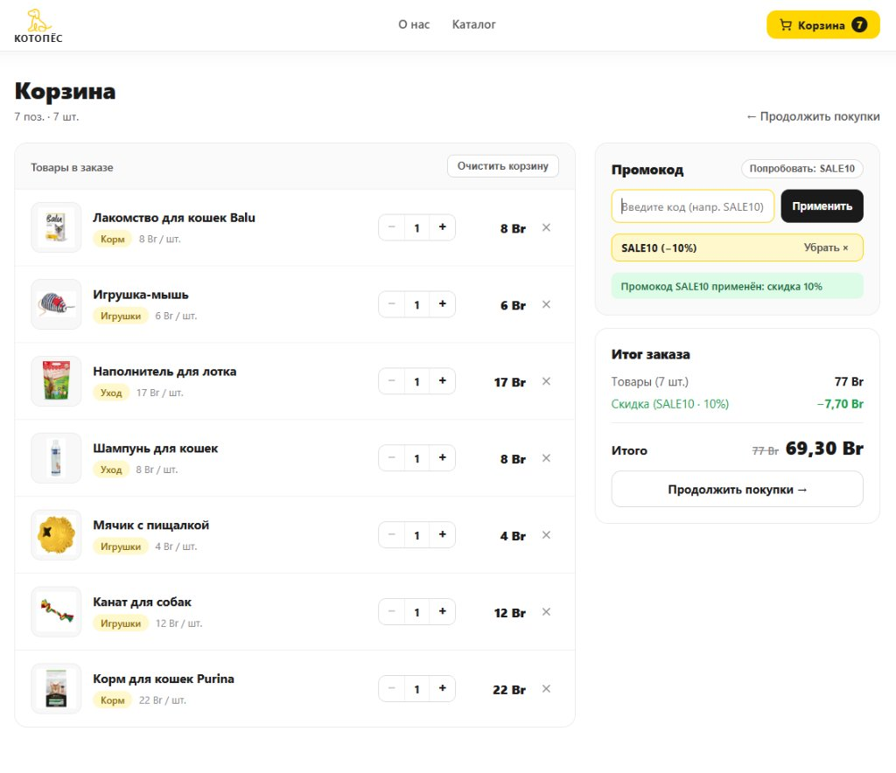

# КотоПёс: an online pet store

КотоПёс is a team frontend project built for RS School. It is a small online store with a catalog of products for cats, dogs, birds and fish, search, filters, product pages and a shopping cart.

**[Live demo](https://skorbezhartem.github.io/rs-team-store/)** · [Issues](https://github.com/SkorbezhArtem/rs-team-store/issues)

**English** | [Русский](README.ru.md)

<p align="center">
  <a href="https://skorbezhartem.github.io/rs-team-store/">
    
  </a>
</p>

## Features

**Catalog**

- 16 demo products in four categories (food, toys, care, accessories) for cats, dogs, birds and fish
- Product cards with a photo, title, category and price
- Search by title, filters by pet and category, price range and sorting

**Product page**

- Opens from a catalog card: photo, description, category, suitable pets and price
- Related products: the same category first, then products for the same pet
- Clear message for an unknown product link

**Cart**

- Add products from the catalog and from the product page
- Change the quantity (never below one), remove items, clear the cart with a confirmation step
- Price of every line and the total
- Promo code `SALE10` gives 10% off; entering it twice does not stack the discount, and it can be removed
- The cart is kept between pages and after a reload (`localStorage`)

Prices are shown in Belarusian rubles (BYN). The interface is in Russian and works on desktop and mobile screens (down to 360 px).

## Screenshots

<table>
  <tr>
    <td width="50%" align="center">
      
      <br />
      <sub><b>About</b> - store overview, categories & team</sub>
    </td>
    <td width="50%" align="center">
      
      <br />
      <sub><b>Catalog</b> - search, pet & category filters, sorting</sub>
    </td>
  </tr>
  <tr>
    <td width="50%" align="center">
      
      <br />
      <sub><b>Product</b> - item details, SKU & related products</sub>
    </td>
    <td width="50%" align="center">
      
      <br />
      <sub><b>Cart</b> - quantity controls, <code>SALE10</code> promo & summary</sub>
    </td>
  </tr>
</table>

## Stack and why

We kept the stack small on purpose.

| Area                   | Tool                            | Why we chose it                                                                          |
| ---------------------- | ------------------------------- | ---------------------------------------------------------------------------------------- |
| Language               | TypeScript                      | Types catch mistakes in the cart and filtering logic before the app runs                 |
| Dev server and build   | Vite                            | Instant start, simple config, easy to publish under a sub-path on GitHub Pages           |
| Interface              | Plain DOM, HTML and CSS         | The app is small, and pages only render while the logic stays in separate pure functions |
| Tests                  | Vitest                          | Works with the Vite setup, tests live next to the code they check                        |
| Code quality           | ESLint and Prettier             | One code style for both authors, checked automatically                                   |
| Automation and hosting | GitHub Actions and GitHub Pages | Checks on every pull request and an automatic deploy from `main`                         |

## Project structure

```text
rs-team-store/
├── .github/workflows/   # CI and deployment
├── docs/screenshots/    # README screenshots
├── public/              # Images, icons and logo
├── src/
│   ├── api/             # Product data service
│   ├── cart/            # Cart actions, store and calculations
│   ├── catalog/         # Filtering and related products
│   ├── components/      # Header, product card, add-to-cart button
│   ├── data/            # Product data
│   ├── pages/           # About, Catalog, Product, Cart
│   ├── styles/          # Design tokens and per-page styles
│   ├── utils/           # Price formatting, asset paths
│   ├── main.ts          # Entry point and hash routing
│   └── types.ts         # Shared types
├── index.html
└── vite.config.ts
```

Unit tests (`*.test.ts`) live next to the modules they cover.

## Getting started

Node.js 22 and npm are required.

```bash
git clone https://github.com/SkorbezhArtem/rs-team-store.git
cd rs-team-store
npm ci
npm run dev
```

### Scripts

| Command                | Purpose                             |
| ---------------------- | ----------------------------------- |
| `npm run dev`          | Start the dev server                |
| `npm run build`        | Type-check and build for production |
| `npm run preview`      | Preview the production build        |
| `npm test`             | Run unit tests                      |
| `npm run lint`         | Run ESLint                          |
| `npm run format`       | Format files with Prettier          |
| `npm run format:check` | Check formatting                    |

## Data and storage

The catalog uses a local set of demo products from `src/data/products.ts`. `src/api/products.ts` exposes asynchronous `getProducts()` and `getProductById()`, so the data source can be replaced with a real API later. No server is needed.

The cart state lives in one place, `cartStore`. It is saved to `localStorage` under the `cart` key and restored on the next visit. Cart actions and calculations are pure functions covered by tests.

## Checks and deployment

GitHub Actions runs ESLint, Prettier, the TypeScript build and the Vitest tests on every pull request and on every push to `main`. After a push to `main` the app is built and published to GitHub Pages automatically.

## Team

We worked together with GitHub Issues, feature branches and pull requests, and reviewed each other's changes before merging into `main`.

### Artem: [SkorbezhArtem](https://github.com/SkorbezhArtem)

- **Project foundation:** Vite + TypeScript project, Vitest, ESLint, Prettier and npm scripts
- **Infrastructure:** GitHub Actions for CI and deployment to GitHub Pages, including the sub-path setup
- **Navigation:** hash routing and the shared header with a live cart counter
- **Cart:** add, change quantity and remove actions, the `cartStore` with subscriptions and `localStorage`, total calculation, promo code `SALE10`, clear-cart confirmation
- **Product page:** detail page, unknown-product state, related products
- **Interface:** price formatting in BYN, design tokens and CSS structure, unified styles, responsive layout

### Kirill: [KirillOlesik](https://github.com/KirillOlesik)

- **Model and data:** `Product` and `CartItem` types, demo products, the products service with unit tests
- **Filtering:** the pure `filterProducts` function (search, category, pet, price range, sorting) with unit tests
- **Catalog:** product cards, the catalog page, search and filter controls connected to `filterProducts`
- **About page:** store description, feature cards and team section
- **Documentation:** English and Russian README

---

_RS School: Team Project Interview_
