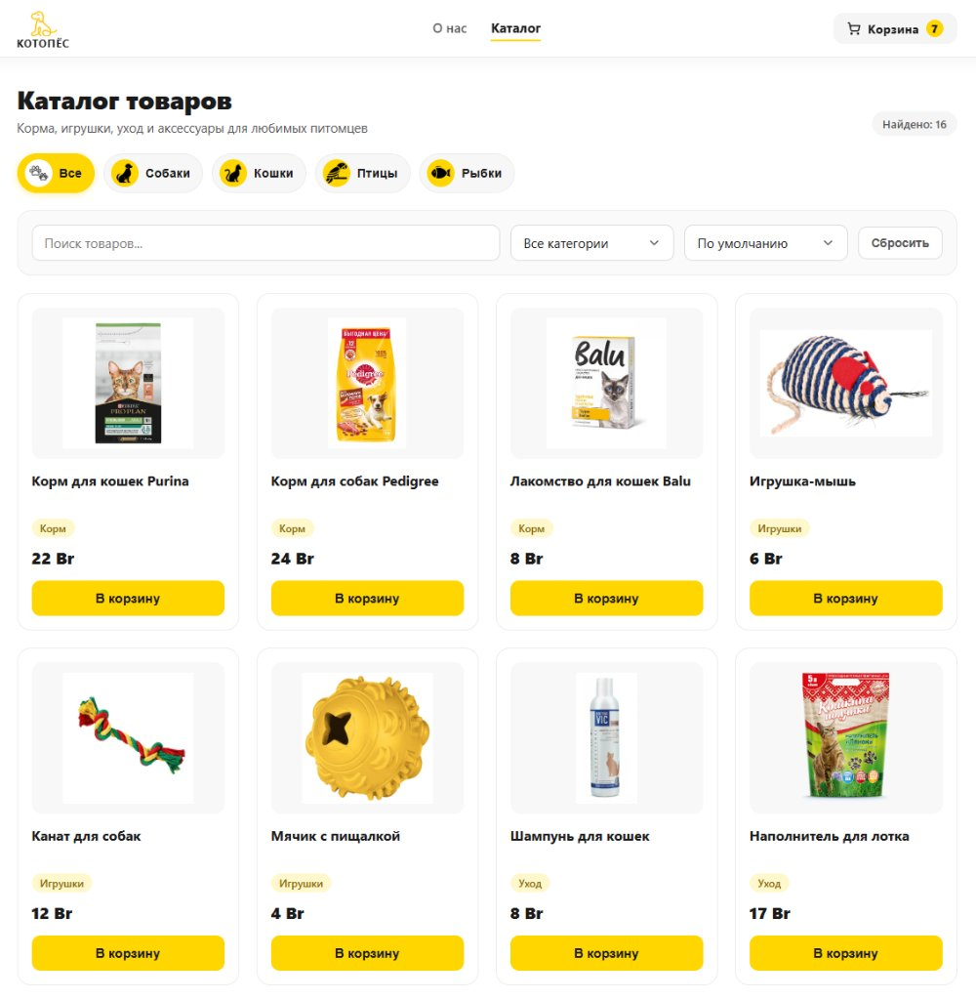
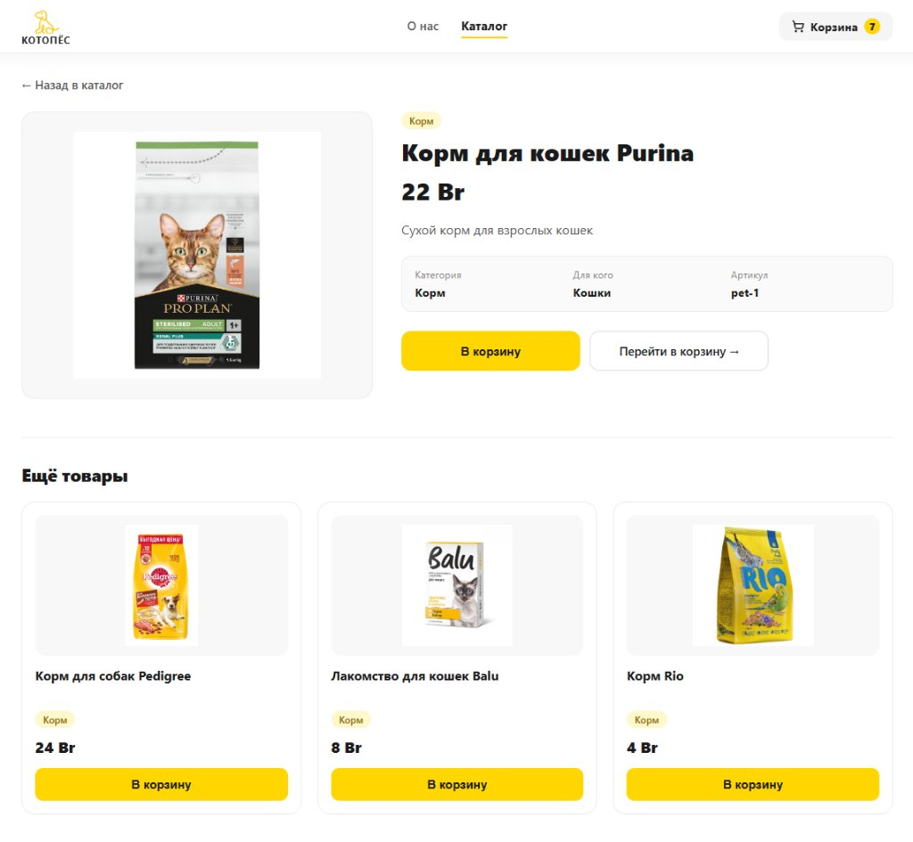
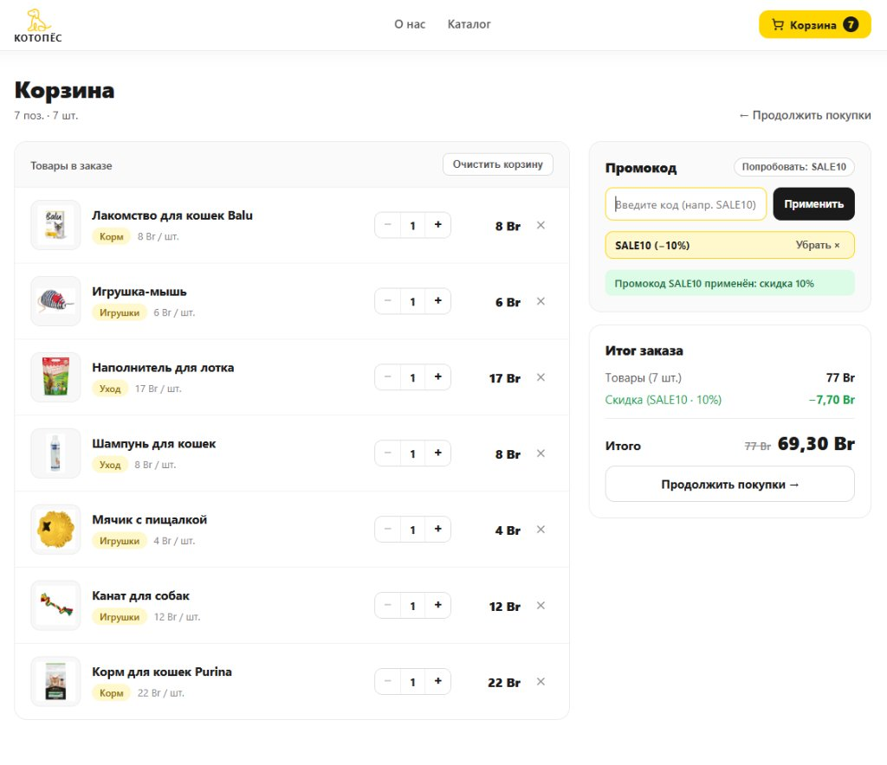

# КотоПёс — интернет-магазин товаров для питомцев

КотоПёс — учебный командный frontend-проект RS School. Это небольшой интернет-магазин с каталогом товаров для кошек, собак, птиц и рыб, поиском, фильтрами, страницей товара и корзиной.

**[Открыть демо](https://skorbezhartem.github.io/rs-team-store/)** · [Issues](https://github.com/SkorbezhArtem/rs-team-store/issues)

[English](README.md) | **Русский**

<p align="center">
  <a href="https://skorbezhartem.github.io/rs-team-store/">
    
  </a>
</p>

## Возможности

**Каталог**

- 16 демонстрационных товаров в четырёх категориях (корм, игрушки, уход, аксессуары) для кошек, собак, птиц и рыб
- Карточки с фотографией, названием, категорией и ценой
- Поиск по названию, фильтры по питомцу и категории, диапазон цен и сортировка

**Страница товара**

- Открывается из карточки каталога: фотография, описание, категория, подходящие питомцы и цена
- Похожие товары: сначала из той же категории, затем подходящие по виду питомца
- Понятное сообщение для несуществующей ссылки на товар

**Корзина**

- Добавление товаров из каталога и со страницы товара
- Изменение количества (не меньше одного), удаление позиций, очистка корзины с подтверждением
- Стоимость каждой позиции и общая сумма
- Промокод `SALE10` даёт скидку 10%; повторный ввод скидку не суммирует, промокод можно убрать
- Корзина сохраняется между страницами и после перезагрузки (`localStorage`)

Цены показаны в белорусских рублях (BYN). Интерфейс на русском языке и адаптирован для компьютеров и мобильных экранов (от 360 px).

## Скриншоты

<table>
  <tr>
    <td width="50%" align="center">
      
      <br />
      <sub><b>О нас</b> - описание магазина, категории и команда</sub>
    </td>
    <td width="50%" align="center">
      
      <br />
      <sub><b>Каталог</b> - поиск, фильтры по питомцу и категории, сортировка</sub>
    </td>
  </tr>
  <tr>
    <td width="50%" align="center">
      
      <br />
      <sub><b>Товар</b> - карточка товара, артикул и похожие товары</sub>
    </td>
    <td width="50%" align="center">
      
      <br />
      <sub><b>Корзина</b> - количество, промокод <code>SALE10</code> и итог заказа</sub>
    </td>
  </tr>
</table>

## Стек и почему он такой

Мы специально оставили стек небольшим.

| Область                 | Инструмент                    | Почему выбрали                                                                           |
| ----------------------- | ----------------------------- | ---------------------------------------------------------------------------------------- |
| Язык                    | TypeScript                    | Типы ловят ошибки в логике корзины и фильтрации ещё до запуска                           |
| Сервер и сборка         | Vite                          | Мгновенный старт, простая настройка, легко публиковать в подпапке GitHub Pages           |
| Интерфейс               | Чистый DOM, HTML и CSS        | Приложение небольшое: страницы только рисуют, а логика лежит в отдельных чистых функциях |
| Тесты                   | Vitest                        | Работает с настройкой Vite, тесты лежат рядом с проверяемым кодом                        |
| Качество кода           | ESLint и Prettier             | Единый стиль кода для обоих авторов, проверяется автоматически                           |
| Автоматизация и хостинг | GitHub Actions и GitHub Pages | Проверки для каждого Pull Request и автоматический деплой из `main`                      |

## Структура проекта

```text
rs-team-store/
├── .github/workflows/   # CI и деплой
├── docs/screenshots/    # Скриншоты для README
├── public/              # Изображения, иконки и логотип
├── src/
│   ├── api/             # Сервис данных о товарах
│   ├── cart/            # Действия, состояние и расчёты корзины
│   ├── catalog/         # Фильтрация и похожие товары
│   ├── components/      # Шапка, карточка товара, кнопка «В корзину»
│   ├── data/            # Данные товаров
│   ├── pages/           # О нас, каталог, товар, корзина
│   ├── styles/          # Дизайн-токены и стили страниц
│   ├── utils/           # Формат цен, пути к файлам
│   ├── main.ts          # Точка входа и hash-маршрутизация
│   └── types.ts         # Общие типы
├── index.html
└── vite.config.ts
```

Тесты (`*.test.ts`) лежат рядом с модулями, которые они проверяют.

## Запуск проекта

Нужны Node.js 22 и npm.

```bash
git clone https://github.com/SkorbezhArtem/rs-team-store.git
cd rs-team-store
npm ci
npm run dev
```

### Команды

| Команда                | Назначение                         |
| ---------------------- | ---------------------------------- |
| `npm run dev`          | Запуск локального сервера          |
| `npm run build`        | Проверка типов и production-сборка |
| `npm run preview`      | Просмотр собранного приложения     |
| `npm test`             | Запуск модульных тестов            |
| `npm run lint`         | Проверка ESLint                    |
| `npm run format`       | Форматирование файлов              |
| `npm run format:check` | Проверка форматирования            |

## Данные и хранение

Каталог использует локальный набор демонстрационных товаров из `src/data/products.ts`. Модуль `src/api/products.ts` предоставляет асинхронные `getProducts()` и `getProductById()`, поэтому источник данных можно заменить на настоящий API. Сервер не нужен.

Состояние корзины хранится в одном месте — `cartStore`. Оно сохраняется в `localStorage` под ключом `cart` и восстанавливается при следующем открытии. Действия с корзиной и расчёты — чистые функции, покрытые тестами.

## Проверки и деплой

GitHub Actions запускает ESLint, Prettier, сборку TypeScript и тесты Vitest для каждого Pull Request и каждого пуша в `main`. После пуша в `main` приложение автоматически собирается и публикуется на GitHub Pages.

## Команда

Мы работали вместе: GitHub Issues, отдельные ветки и Pull Requests, ревью друг друга перед слиянием в `main`.

### Артём — [SkorbezhArtem](https://github.com/SkorbezhArtem)

- **Основа проекта:** Vite + TypeScript, Vitest, ESLint, Prettier и npm-скрипты
- **Инфраструктура:** GitHub Actions для CI и деплоя на GitHub Pages, включая работу в подпапке репозитория
- **Навигация:** hash-маршрутизация, общая шапка со счётчиком корзины
- **Корзина:** добавление, изменение количества и удаление, хранилище `cartStore` с подписками и `localStorage`, расчёт суммы, промокод `SALE10`, очистка корзины с подтверждением
- **Страница товара:** подробная страница, состояние «товар не найден», похожие товары
- **Интерфейс:** формат цен в BYN, дизайн-токены и структура CSS, единый стиль, адаптив

### Кирилл — [KirillOlesik](https://github.com/KirillOlesik)

- **Модель и данные:** типы `Product` и `CartItem`, демонстрационные товары, сервис товаров с тестами
- **Фильтрация:** чистая функция `filterProducts` (поиск, категория, питомец, диапазон цен, сортировка) с тестами
- **Каталог:** карточки, страница каталога, поиск и фильтры, связанные с `filterProducts`
- **Страница «О нас»:** описание магазина, карточки возможностей и блок команды
- **Документация:** README на английском и русском

---

_RS School - Team Project Interview_
